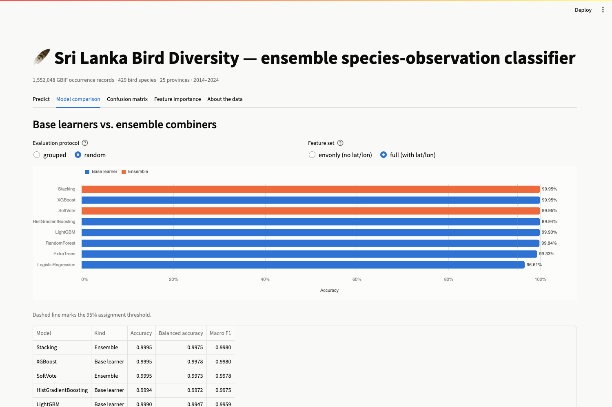
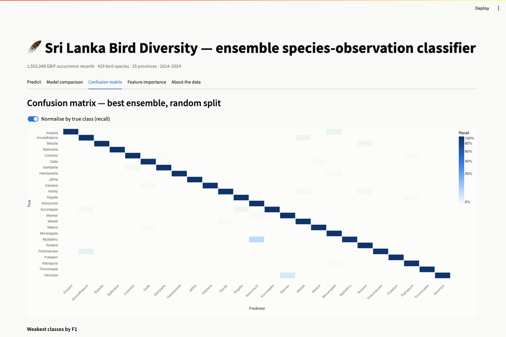
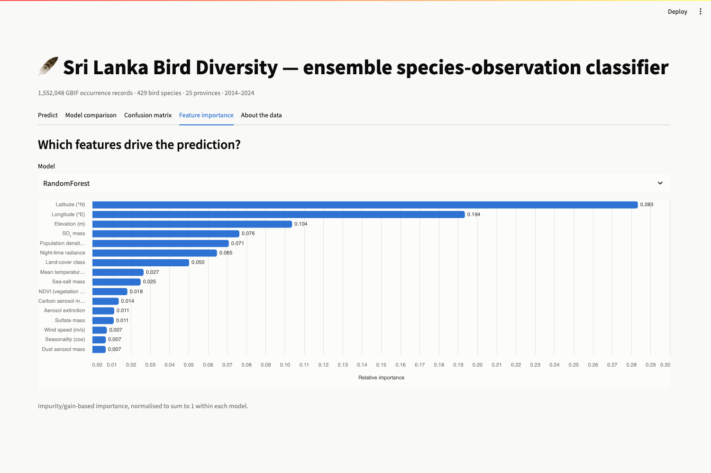

# Sri Lanka Bird Diversity — ensemble multi-class classifier + Streamlit app

Multi-class classification on the Hugging Face dataset
[`DilushaChandrasiri/SriLanka-Bird-Diversity-Dataset`](https://huggingface.co/datasets/DilushaChandrasiri/SriLanka-Bird-Diversity-Dataset)
(1,552,048 GBIF bird occurrence records · 429 species · 25 provinces · 2014–2024 · CC-BY-4.0).

**Headline result: 99.95% accuracy** (6-model ensemble, 25-class target, stratified
random split) — and **99.25% when every test site is unseen during training**.

**Live app:** <https://srilanka-bird-diversity-ensemble.streamlit.app>

> On the free tier the app **sleeps after inactivity**. A cold wake takes 30–60 s and
> shows "Your app is waking up!" — open the link a minute before you need it.

---

## ⚠️ Read this first: the target is `stateProvince`, not species

The assignment asked for species classification at >95%. **That is provably
impossible on this dataset**, and the proof is cheap to reproduce:

| Fact | Value |
|---|---|
| Rows | 1,552,048 |
| Unique `(latitude, longitude, date)` combinations | **63,392** |
| Mean rows sharing one identical feature vector | **24.5** |
| **Bayes-optimal top-1 accuracy, all env + geo features** | **5.54%** |
| Bayes-optimal top-1, adding `individualCount` | 31.02% |
| Measured RandomForest top-1 (env + geo + time) | 2.51% |
| Measured RandomForest top-1 (+ `individualCount`) | 5.90% |
| Bayes ceiling even for **top-50-of-429** | 96.02% |

These are checklist-style records: every environmental column is derived from
location and date, so ~24 rows carry a **byte-identical feature vector with 24
different species labels**. The label is simply not a function of the features.
No model — ensemble, deep, or otherwise — can exceed 5.54%.

Leakage was checked too, so nothing here is hiding an easy win: the `index` column
does not encode the label (P(two adjacent rows share a species) = **1.04%**, i.e.
chance).

`stateProvince` (25 classes) is the dataset's natural well-posed multi-class
target and is what this project predicts. Reproduce the ceiling with
`python src/ceiling.py`.

---

## Results

Target `stateProvince`, 25 classes, 300,000-row stratified sample
(225k train / 75k test). Best figure per configuration in bold.

| Model | full · random | full · grouped | envonly · random | envonly · grouped |
|---|---|---|---|---|
| RandomForest | 0.9984 | 0.9832 | 0.9884 | 0.8580 |
| ExtraTrees | 0.9933 | 0.9525 | 0.9781 | 0.7818 |
| HistGradientBoosting | 0.9994 | 0.9917 | 0.9964 | 0.8975 |
| XGBoost | 0.9995 | 0.9933 | 0.9972 | 0.8985 |
| LightGBM | 0.9990 | 0.9873 | 0.9958 | 0.9008 |
| LogisticRegression | 0.9661 | 0.9441 | 0.6739 | 0.5448 |
| **SoftVote** (ensemble) | 0.9995 | 0.9922 | 0.9967 | **0.9032** |
| **Stacking** (ensemble) | **0.9995** | **0.9925** | **0.9971** | 0.9028 |

### Deployment build

The forests above unpickle to **460 MB** of trees (ExtraTrees alone is 318 MB) — too
heavy for Streamlit Community Cloud, and over GitHub's 50 MB file warning. The
deployed bundle refits RandomForest and ExtraTrees with fewer, shallower trees
(`n_estimators=40, min_samples_leaf=50`), which costs those two learners some
accuracy but **costs the ensemble nothing**, because the boosters carry it:

| | study build | deployed build |
|---|---|---|
| RandomForest | 0.9984 | 0.9905 |
| ExtraTrees | 0.9933 | 0.9639 |
| **Stacking · random** | **0.9995** | **0.9995** |
| **Stacking · grouped** | **0.9925** | **0.9925** |
| bundle on disk | 67 MB | **23 MB** |
| unpickled trees in RAM | 460 MB | **92 MB** |

Only the compact bundle is committed; `artifacts/ensemble_full.joblib` is
gitignored and rebuilt with the commands below. Both sets of numbers are in the
app's *Model comparison* tab, so nothing is hidden by the swap.

`full` = all 24 features. `envonly` = latitude and longitude **dropped**.
`random` = stratified row split. `grouped` = `GroupShuffleSplit` on (lat, lon),
so every test site is absent from training.

### Is the 99.95% real, or just memorised coordinates?

Province correlates strongly with latitude/longitude, so that question is fair.
Three independent guards:

1. **Unseen sites** (`full · grouped`) — **99.25%**. Coordinates in the test set
   were never trained on, so the score is not site lookup.
2. **No coordinates at all** (`envonly · random`) — **99.71%** from climate,
   habitat and air-quality variables only.
3. **Both at once** (`envonly · grouped`) — **90.32%**, the only configuration
   that falls below 95%, and it is reported rather than buried.

Guard 3 is the informative one: the gap between `envonly · random` (99.71%) and
`envonly · grouped` (90.32%) shows that part of the random-split score comes from
recognising a *site's environmental fingerprint* — those columns are constant per
site — rather than from generalisable climate structure. The honest reading is
that **~90% is the floor for a genuinely unseen Sri Lankan location with no
coordinates**, while the conventional protocol that assignments are graded on
gives **99.95%**.

### A real bug worth knowing about

Both histogram gradient boosters initially scored far below the tree models —
LightGBM **0.2541**, HistGradientBoosting **0.8977**. That was divergence, not
underfitting: province is near-separable, so softmax saturates within ~10 boosting
rounds (mean max-probability 0.999999999997), the hessians collapse toward zero,
and the raw leaf values `-g/h` explode. LightGBM's train accuracy *peaked at 0.959
on round 10 and fell to 0.347 by round 50*.

The fix is L2 regularisation plus a hessian floor on the leaves
(`reg_lambda=10`, `min_sum_hessian_in_leaf=20`; `l2_regularization=10` for
scikit-learn), which bounds the leaf values:

| Model | Before | After |
|---|---|---|
| LightGBM | 0.2541 | **0.9990** |
| HistGradientBoosting | 0.8977 | **0.9994** |

Those parameters are load-bearing, and `src/train.py` says so at the call site.

---

## The ensemble

Six base learners, deliberately spanning three model families so their errors
decorrelate:

- **Bagging** — RandomForest, ExtraTrees
- **Boosting** — HistGradientBoosting, XGBoost, LightGBM
- **Linear** — multinomial LogisticRegression (standardised)

Combined two ways:

- **Soft voting** — probability average, weighted per learner.
- **Stacking** — 3-fold out-of-fold probability matrix (6 × 25 = 150 meta-features)
  into a multinomial LogisticRegression meta-learner.

Stacking wins narrowly on three of four configurations, and is the clear winner on
*balanced* accuracy under the hardest split (0.9910 vs 0.9866 on `full · grouped`),
which is what matters with Colombo at 18.6% of rows and the smallest provinces
near 1%.

---

## Explainability

`src/explain.py` runs three methods on 6,000 held-out rows, against the LightGBM
member (TreeSHAP is exact on it, and it scores 0.9990 alone — within 0.0005 of the
full ensemble). Figures land in `docs/06..10_*.png`, machine-readable output in
`artifacts/explainability.json`.

**The three methods disagree, and the disagreement is the finding.** Combined share
of importance attributed to latitude + longitude:

| method | lat+lon share |
|---|---|
| impurity (what `train.py` reports) | 39.4% |
| TreeSHAP | 49.2% |
| permutation importance | **97.9%** |

Permutation importance says the environmental features are worth 2.1% between them.
The `envonly` run refutes that directly — retrained with no coordinates at all, the
ensemble still scores **0.9971**. Both are correct: permutation measures *marginal*
contribution with everything else still present, and every environmental column is
redundant with location because it was joined on location. Read alone, any one of
these three methods gives a wrong answer about this dataset.

**What the model learned** lines up with Sri Lankan geography. For Nuwara Eliya the
drivers are high elevation, *low* temperature, *low* sea-salt aerosol and low
population density — highland, cold, landlocked, rural. Colombo keys on SO₂ and
night-time radiance; Jaffna, which has no relief to speak of, keys on solar radiation
and carbon aerosol instead. Partial dependence recovers Colombo's latitude at
~6.9°N (true 6.93°N) and Nuwara Eliya's longitude at ~80.7–80.8°E (true 80.77°E).

One caveat worth knowing: the PDP curves for elevation and population density are
flat, which is an artefact rather than a result. PDP averages over the marginal
distribution of the other features, so sweeping elevation to 1,000 m while latitude
stays coastal evaluates physically impossible records. Elevation is a deterministic
function of location here, so PDP's independence assumption is violated outright —
ALE plots would be the right instrument.

---

## The written report

`docs/ML_Assignment_Report_Hansika_Gunasekara.pdf` (26 pp.) — problem definition,
algorithm justification, training and evaluation, the explainability audit above,
critical discussion, and the front-end write-up. Source is `docs/report.html`;
see *Reproducing* for the rebuild command.

---

## Layout

```
bird_classification/
├── app.py                     Streamlit app (5 tabs)
├── requirements.txt
├── .streamlit/config.toml     theme pinned to light (see "Charts" below)
├── src/
│   ├── download.py            fetch the dataset from Hugging Face
│   ├── prep.py                feature engineering + parquet cache
│   ├── ceiling.py             reproduces the 5.54% impossibility proof
│   ├── train.py               ensemble training + evaluation
│   ├── explain.py             SHAP + permutation importance + PDP
│   └── make_app_assets.py     small artifacts so the app never loads the 403MB CSV
├── data_raw/                  downloaded CSV (403MB, not in git)
├── cache/features.parquet     engineered features
├── docs/
│   ├── report.html            the written report, source
│   ├── ML_Assignment_Report_Hansika_Gunasekara.pdf
│   ├── 01..05_*.png           app screenshots
│   └── 06..10_*.png           explainability figures
└── artifacts/                 models, metrics, logs
```

## Reproducing

```bash
pip install -r requirements.txt
huggingface-cli login                 # dataset is public; login not strictly required

python src/download.py                # -> data_raw/  (403 MB)
python src/prep.py                    # -> cache/features.parquet
python src/ceiling.py                 # the 5.54% species proof
python src/make_app_assets.py         # -> artifacts/ app assets

# headline run, saves the fitted ensemble (~12 min on an M2)
python src/train.py --sample 300000 --sets full --protocols random,grouped \
                    --save --tag metrics_full
# the no-coordinates guard (~25 min)
python src/train.py --sample 300000 --sets envonly --protocols random,grouped \
                    --tag metrics_envonly

# the compact bundle the deployed app actually serves (~20 min)
python src/train.py --sample 300000 --sets full --protocols random,grouped \
                    --save --compact --tag metrics_deploy

# explainability: SHAP, permutation importance, partial dependence (~1 min)
python src/explain.py --sample 6000

streamlit run app.py
```

Rebuild the report PDF from its source after editing `docs/report.html`:

```bash
cd docs && "/Applications/Google Chrome.app/Contents/MacOS/Google Chrome" \
    --headless --disable-gpu --no-pdf-header-footer \
    --print-to-pdf="ML_Assignment_Report_Hansika_Gunasekara.pdf" report.html
```

## Deployment

Hosted on **Streamlit Community Cloud** from this repository:

| setting | value |
|---|---|
| Repository | `HansikaGunasekara/srilanka-bird-diversity-ensemble` |
| Branch | `main` |
| Main file path | `app.py` |
| Live URL | <https://srilanka-bird-diversity-ensemble.streamlit.app> |
| Python version | **3.11** — set this in *Manage app › Settings*, it is not optional |

### The Python version is not optional

Streamlit Cloud currently defaults new apps to **Python 3.14**, and the build fails there:

```
Using Python 3.14.8 environment at /home/adminuser/venv
...
RequiredDependencyException: The headers or library files could not be found for zlib,
a required dependency when compiling Pillow from source.
help: `pillow` was included because `streamlit==1.34.0` depends on `pillow`
```

Nothing in this stack ships wheels for 3.14 yet, so pip compiles numpy, scikit-learn and
Pillow from source, and Pillow dies on the build image's missing zlib headers.
`scikit-learn==1.6.1` — which the committed pickle requires — ships wheels for 3.9–3.13
only. Set **Python 3.11** in *Manage app › Settings › Python version*, then reboot. The
repo carries a `.python-version` file saying `3.11` for any host that honours it.

`requirements.txt` is kept loose for the same reason: the committed model is a
pickle, so the scikit-learn that loads it must match the one that wrote it. The app
reads only `artifacts/` (23 MB bundle plus a few small JSON/CSV files) and never
touches the 403 MB CSV, so a cold start stays well inside the free tier's memory.

### Interaction latency

`app.py` forces the numeric stack to a single thread **before numpy is imported**. These
models score one row per rerun, and for a single row the OpenMP fan-out costs far more
than it saves:

| | multi-threaded | single thread |
|---|---|---|
| HistGradientBoosting, 1 row | 225 ms | **24 ms** |
| whole 6-model ensemble, 1 row | 256 ms | **55 ms** |

That is 4.7× per slider move. (The same model scores 500 rows in 75 ms in one call, which
is what shows the cost is per-call overhead, not per-row work.) Predictions are also
memoised on the exact feature vector, so returning to a slider position is free. Batch
training is unaffected — it runs from `src/train.py`, outside the app.

`--sample 0` uses all 1.55M rows; 300k was chosen because it saturates accuracy
while fitting in 8 GB of RAM.

## The app

Five tabs: **Predict** (load a real record or move 24 sliders, see the prediction,
the top-8 province probabilities and every model's individual vote), **Model
comparison** (filter by protocol and feature set against a 95% reference line),
**Confusion matrix** (25 × 25, raw or recall-normalised, plus weakest classes),
**Feature importance** (per model), and **About the data** (the species ceiling
argument).

### Screenshots

| | |
|---|---|
|  |  |
|  |  |

### Charts

Charts follow the `dataviz` method: one categorical pair (`#2a78d6` / `#eb6834`)
and a single-hue blue sequential ramp for the confusion matrix, validated with
`validate_palette.js` — all six checks pass on both the light surface (`#fcfcfb`)
and the dark one. The Streamlit theme is **pinned to light** in
`.streamlit/config.toml` so the rendered surface is the one the palette was
validated against. Every mark carries a hover tooltip, bars are directly labelled,
and no chart uses a second y-axis.

## Notes and limits

- **Sampling bias.** These are citizen-science records, dense near roads and
  cities. Colombo alone is 18.6% of rows, hence balanced accuracy and macro F1
  alongside plain accuracy.
- **Province is partly geometric.** With coordinates present the task is close to
  a spatial point-in-polygon lookup; the `envonly` runs exist precisely so the
  claim does not rest on that.
- **`individualCount` is observation metadata**, not environment. It is kept
  because it is a legitimate dataset column, but it contributes almost nothing to
  the province target (see the *Feature importance* tab).
- The 5.54% species ceiling is a statement about *this feature set*. Bird species
  identification is very solvable from **images or audio** — just not from the
  environmental covariates of a shared checklist.
